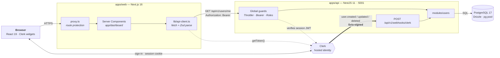
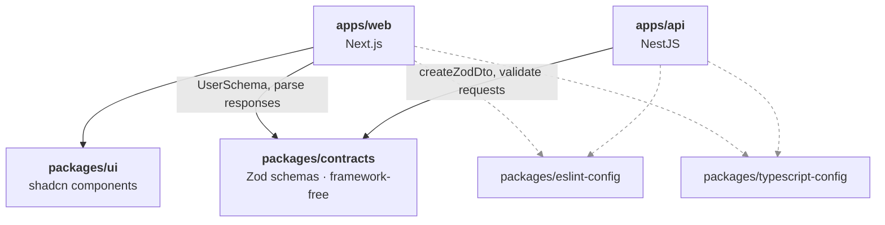
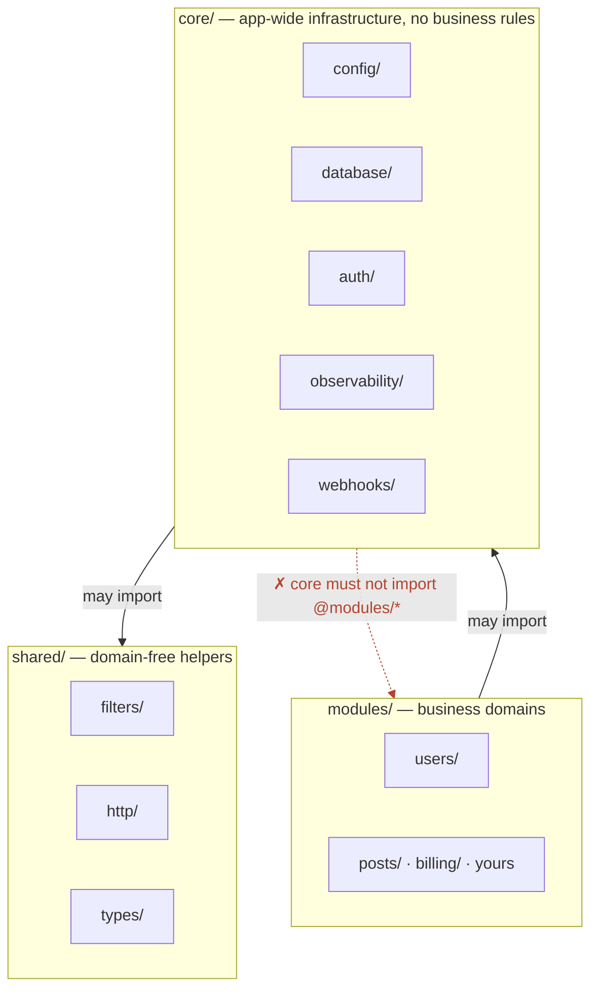
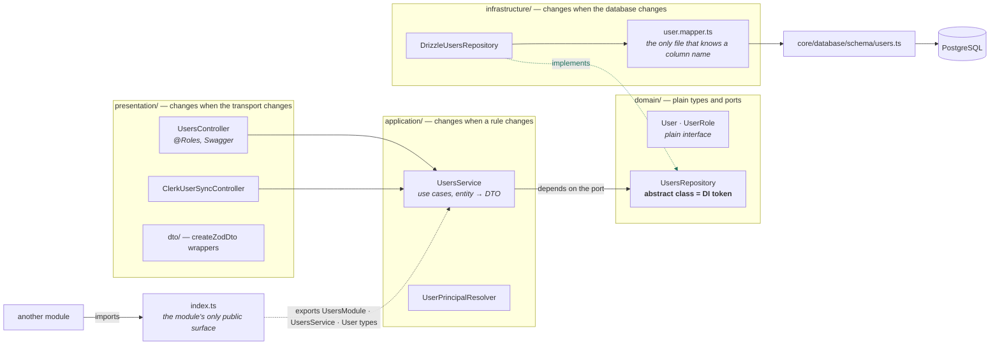
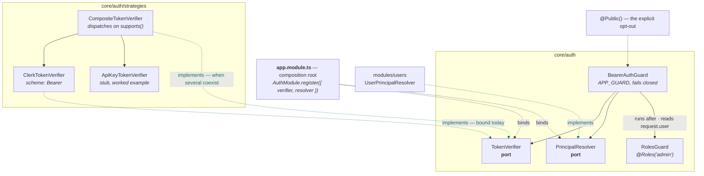
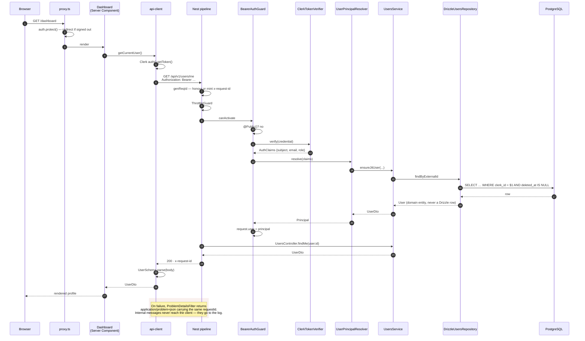
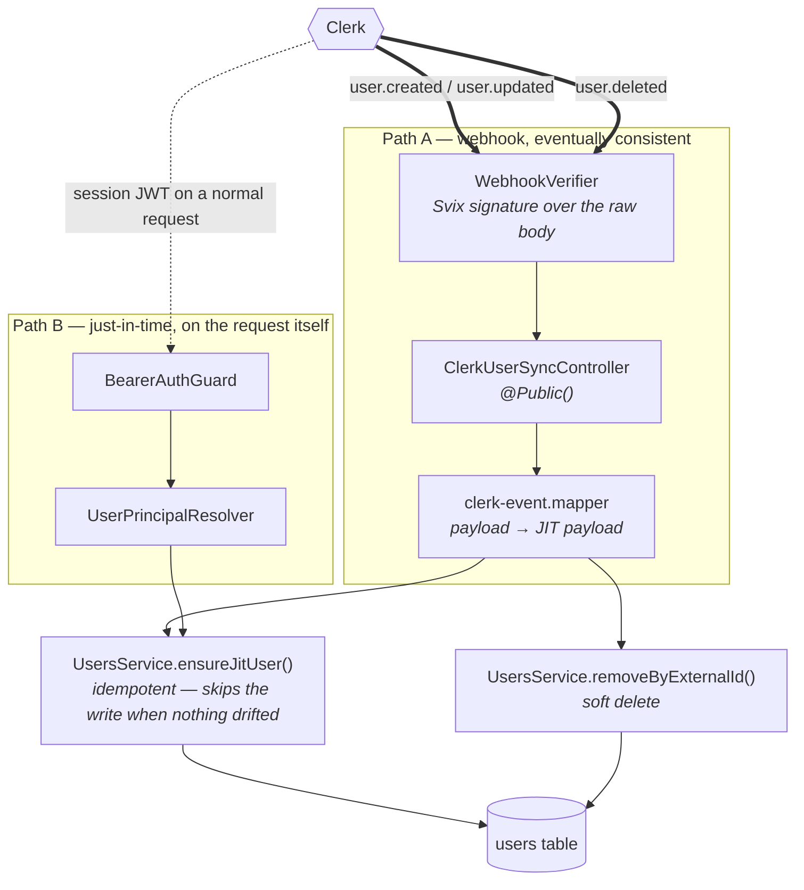
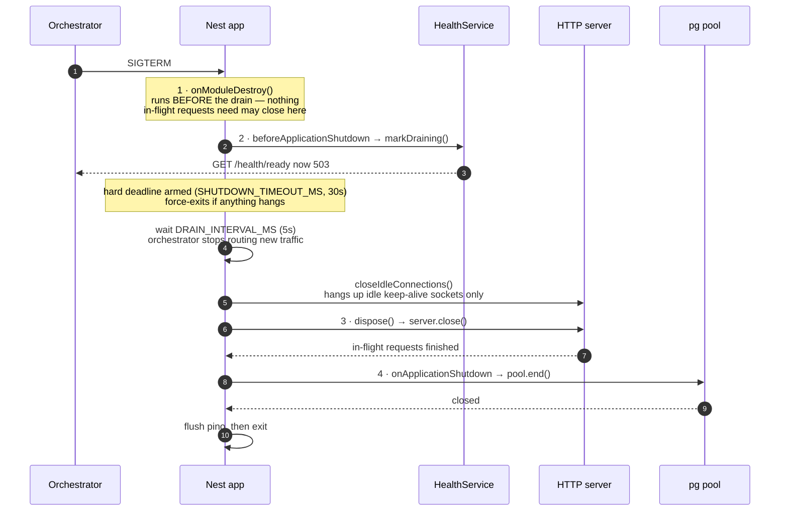

# Architecture

Eight diagrams, working from the outside in: what talks to what, how the workspace is
wired, which direction dependencies point inside the API, and what happens on the two
paths that are easy to get wrong — an authenticated request and a shutdown.

Prose lives elsewhere and is not repeated here. The reasoning behind the API layout is
[`adr/0001-layered-modules.md`](adr/0001-layered-modules.md); the error and logging
taxonomy is [`LOGGING_AND_ERROR_HANDLING.md`](LOGGING_AND_ERROR_HANDLING.md).

---

## 1. System context

Two deployables, one database, one hosted identity provider. Everything a browser sees
comes from the Next.js app; the API is never called from the browser directly, because
the token is fetched server-side.



`proxy.ts` is a redirect for humans, not the security boundary — the API authorizes every
request independently, so a matcher change in the proxy cannot silently expose data.

---

## 2. Workspace and build order

Solid edges are runtime dependencies, dashed edges are build and lint tooling. Turbo's
`build` task declares `dependsOn: ["^build"]`, so `packages/contracts` compiles before
either app — which is why `pnpm dev` must be run from the repo root and not with
`pnpm --filter api dev`.



`contracts` is deliberately framework-free — no Nest imports — because the browser bundle
imports it too. The API binds the same schemas as runtime DTOs through `nestjs-zod`; the
web client parses responses against them. Drift fails at the boundary rather than as an
`undefined` deep in a component.

---

## 3. Dependency direction inside `apps/api`

Three top-level areas, and imports only ever point downward.



The forbidden edge is not a convention — it is a `no-restricted-imports` zone in
[`apps/api/eslint.config.mjs`](../apps/api/eslint.config.mjs), and
`pnpm --filter api lint` runs with `--max-warnings 0`, so a violation fails the build
rather than scrolling past.

When `core` genuinely needs something only a domain can provide, it declares a port and
the module implements it — the dependency still points downward. Figure 5 shows that
inversion for authentication.

---

## 4. Inside a module: ports and adapters

`modules/users` in full. The domain sits at the centre and depends on nothing; the
adapter on the right points _inward_ at the port, which is what makes the data source
swappable.



Bound in `users.module.ts`, and this line is the whole of the swap:

```ts
{ provide: UsersRepository, useClass: DrizzleUsersRepository }
```

Ports are **abstract classes, not interfaces**: an interface is erased at compile time and
cannot be a Nest DI token. For the same reason, never write `import type` on a port — it
erases the runtime value and DI fails at boot while typecheck stays green.

To place a new file, ask what would force it to change. A different database is
`infrastructure`; a different transport is `presentation`; a different rule is
`domain`/`application`. Two answers means it needs splitting.

---

## 5. Authentication: a guard that knows no provider

`BearerAuthGuard` contains no Clerk imports. It delegates to two ports, and both are
supplied from the composition root in `app.module.ts`. This is the inversion Figure 3
refers to: `core/auth` defines `PrincipalResolver`, and `modules/users` implements it, so
`core` still imports nothing from `modules`.



A route is protected unless it says otherwise, so a newly added endpoint is safe by
default. Moving to Auth0 is a new `TokenVerifier` and a changed binding, not a rewrite.
Supporting session tokens _and_ machine API keys at once is `CompositeTokenVerifier`; the
guard still does not change.

---

## 6. An authenticated request, end to end

`GET /users/me` from the dashboard. The correlation id is the thread to follow — it is
minted or honoured on the way in, attached to every log line, echoed on the response, and
placed in the error body, so a user's screenshot maps to one request in the logs.



Log level follows the response status rather than the exception class, and each failure
logs exactly once.

---

## 7. Two paths keep the local `users` row in sync

Clerk owns identity; a local `users` table exists so other tables have a foreign key to
point at. Two independent paths write it, and both converge on the same idempotent
operation, so neither is a single point of failure.



Two details that are load-bearing:

- The signature is verified over the **raw bytes**, which is why `main.ts` bootstraps with
  `rawBody: true`. Verifying a re-serialised body silently passes on some payloads and
  fails on others.
- The webhook path keeps a fallback for a missing email, while the request path
  **fails closed** and returns `401`. Clerk retries a non-2xx webhook response, so an
  emailless `user.created` that rejected would retry forever.

---

## 8. Graceful shutdown

The ordering here is the whole point, and it is not the order you would write by
accident. Nest runs its lifecycle hooks in a fixed sequence; putting a step in the wrong
hook fails every request that arrives during the drain.



- **Readiness fails first, liveness never does.** `/health/live` deliberately checks
  nothing but the process — if it pinged the database, a database blip would make
  Kubernetes restart every healthy pod.
- **The pool closes in step 4, not step 1.** `onModuleDestroy` runs before the drain
  window; closing the pool there would tear it down seconds before the server stops
  accepting traffic.
- **Idle sockets are hung up before `close()`.** `server.close()` waits for sockets to go
  idle on their own, and a load balancer holds keep-alive sockets open continuously — so
  without this, every ordinary deploy would end at the hard deadline with `exit(1)`.
- **`useProcessExit: true`.** Nest's default re-raises the signal via `process.kill()`,
  discarding whatever pino still holds in its transport worker — in practice the entire
  tail of the shutdown log, which is the part you need when a deploy misbehaves.
